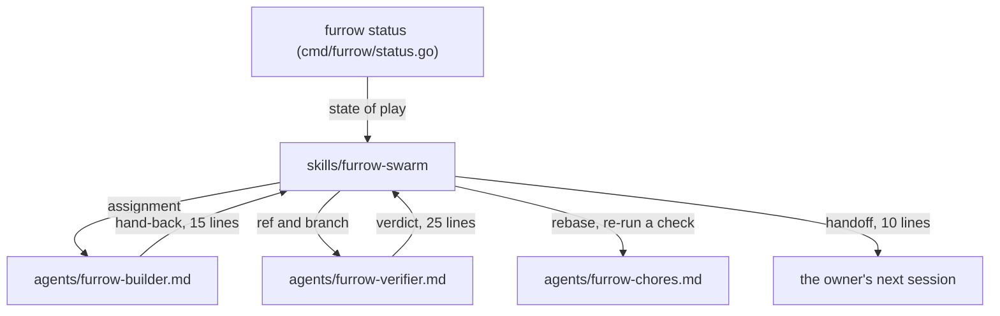

# Agents

The Claude Code plugin: the skills that teach an agent, or a swarm of them, to work with Furrow.

## Behaviour

Furrow ships a Claude Code plugin from the repo root. `.claude-plugin/plugin.json` names it
`furrow`, and `.claude-plugin/marketplace.json` lists it with source `./`. Install it with
`/plugin marketplace add devenjarvis/furrow`. Its skills live in `skills/`, and this repo's
`.claude/skills` links there, so Furrow's own agents use what it ships.

- **furrow-next**: pick the top ready step (or the one given), read the spec, its context, its area
  and the Decisions of what it comes after, `furrow claim` it (exit 3: pick again), open the draft
  PR `[REF] title` with `furrow brief`'s output as its body (the brief is the template; no other),
  and plan one test per covered criterion. A step `claim` says is `Stacked on` a branch gets its
  PR based on that branch, linked with `gh stack link` when `gh stack` is installed.
- **furrow-implement**: tests first, stay inside `touches` (`furrow territory`), run the repo's
  check, tick covered criteria with evidence, and log decisions. Then it keeps the spec's diagram
  current, captures visual proof before and after with the repo's own tools when the brief has a
  Visual proof section (a screenshot is evidence for the owner, never a reason to tick a `human:`
  box), and fills every brief placeholder for an owner on a phone: Before and After as a user or
  caller sees them, at most 20 words each; one "show it" (a command and its output, a screenshot,
  or a call and its result) as an excerpt of at most 15 lines; at most 3 Review this items, each a
  place in the code and the question to ask; and how the diff touches each invariant. It writes
  each `## Decisions` line in at most 30 words. `furrow brief --check` and `furrow territory --body-file` on the description must
  both exit 0 before `furrow done`. On a spec's last step it folds the change, and the diagram, into
  the area's Behaviour. `furrow done` is pushed before the PR is marked ready, never after, so the
  step is handed back and steps can stack on it. A stacked step rebases onto its parent when the
  parent changes, and onto the base if the parent merged without GitHub rebasing it. Problems go under "Spec problem", never into the criteria.
- **furrow-verify**: a skeptic's review: every covered criterion's proof, territory with the PR
  body, the brief (`furrow brief --check`, then Before and After, each diagram node and edge, each
  image, the Judgment calls and the invariant lines read against the diff; it re-runs a cheap
  "show it" command and compares the output, and checks each Review this item names real code; a
  claim the diff doesn't bear out is a finding),
  invariants, spec hygiene, the repo's check, and a verdict table. A stacked step's PR must be based on
  its parent's branch. Run as a sub-agent, its report is only the verdict table, the findings and a
  `ready to merge: yes` or `ready to merge: no` line, at most 25 lines.
- **furrow-write**: `furrow new`, then steps with small non-overlapping touches, honest `after`
  and invariants, a proof for every criterion, lint and graph. A spec that changes structure draws
  it in `## What` as a mermaid diagram to the standard's rules. Every open question gets
  `Proposed:`. It opens the spec's PR with `furrow brief --spec` (regenerated with `--pr N`), fills
  the Decision's `**Commits us to:**` and `**Instead of:**` lines, at most 25 words each, runs
  `--check`, and opens one review thread per question. When the owner overrules
  one, it moves the question to `## Decisions` as an `Owner chose … over the proposed …` line and
  regenerates the brief; if a `Qn` is ambiguous it asks. On an amendment, Your calls lists only
  new questions: ones decided when the spec merged aren't asked again. It never merges or accepts a spec.
- **furrow-swarm**: the skill for building, working through the queue or working in parallel.
  It starts from `furrow status`, then `furrow next --agents N --json`, one worktree and background
  `furrow-builder` agent per assignment. Each builder hands back in at most 15 lines: each command
  with its exit code, decisions one line each, a spec problem or `none`, and raw output only for a
  failure, at most 20 lines. Each hand-back is verified in a fresh `furrow-verifier` agent, never in
  the orchestrator; it merges on `ready to merge: yes` only once every check has passed on the PR's head commit (a red check goes to `furrow-chores`, never merged), and sends `no` findings back to the builder.
  Chores (rebasing a stacked step, merging the base when only `specs/` conflicts, re-running the
  check, reading a CI failure) go to `furrow-chores`; anything else goes back to the builder. It
  hands out newly unblocked steps as slots free up and archives finished specs. With `stack:` on, a
  hand-back frees work too: what waits on it is handed out stacked on it. It runs wave after wave
  in one session; after a compaction it runs `furrow status` before handing out more. It never
  stops to ask the owner while work can move: it parks, in one line each, what only the owner can
  settle (a spec problem, a closed parent PR, a step that came back `no` three times, a CI failure
  a chore can't explain or that fails its one re-run, a blocker outside Furrow), keeps a parked
  step's claim, and runs `furrow release <ref>` when the problem is the step itself. It stops only
  when `furrow next` offers nothing that doesn't overlap a parked claim, no agent is out, and no
  step PR waits on CI or a verifier, with a handoff of at most 10 lines holding only what the repo
  doesn't (the parked list, blockers outside Furrow) and ending `Start a new session with: Run
  furrow status, then furrow-swarm.` Its report starts with **Parked**, each ref with what the
  owner needs to do, then what waits on the owner, each stack bottom to top, since the owner
  reviews from the bottom.

**Agents.** The plugin ships three agent definitions in `agents/`, and this repo's `.claude/agents`
links there. `furrow-builder` claims and builds one step and returns the 15-line hand-back;
`furrow-verifier` runs `furrow-verify` and returns the 25-line verdict; both say `model: opus`, so
they run on Opus whatever the session runs on. `furrow-chores` (`model: sonnet`) does the chores and
returns at most 10 lines. The swarm's own session, the orchestrator, runs on Haiku; one on another
model tells the owner once and carries on. Each repeats
the rules it needs: never tick a `human:` box, never sign off, never edit a criterion's text, work
only in its worktree. A project overrides one by copying it into its own `.claude/agents/`.

Where each step's detail lives, and what reaches the orchestrator.

Legend: a box is a command, skill, agent or session; an arrow is what one hands the next, as
labelled.

No skill tells an agent to sign off, tick a `human:` box, accept a spec, or change a criterion's
text.

## History

- FUR-0007: A Claude Code plugin that teaches agents, and swarms, to work with Furrow (archived 2026-11-03)
