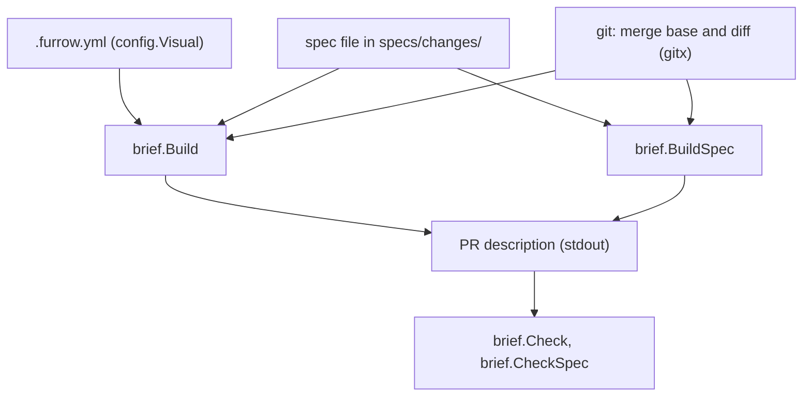

# Reviewer brief

The brief a step's PR carries for its reviewer: `furrow brief` and `furrow brief --check`.

## Behaviour

`furrow brief` writes the PR description a reviewer reads before the diff. It reads only the
working tree and git (INV-2), posts nothing, and prints the same bytes for the same repo state,
with no dates (INV-6). The agent pastes it into the PR with the forge's tools.

How `furrow brief` turns the spec and the diff into a PR description, and how `--check` reads it
back.



Legend: each box is a file, git, or a function in `internal/brief`; an arrow points where its data
goes next. No colours.

**`furrow brief [--step REF] [--base REF] [--json]`** briefs one step. The step and base are found
as `furrow territory` finds them, and "changed files" means what `territory` means. Sections, in
this order:

1. `## Behaviour`: a placeholder for before → after, in at most 80 words.
2. `## Diagram`, when the spec's `## What` holds a ```` ```mermaid ```` block: each block copied
   as is, under a placeholder asking for a caption and what this step adds (`classDef added`), and
   followed by a `Legend: <!-- furrow: … -->` line.
3. `## Where to look`: changed files grouped **Specs** (under the config's `specs` folder),
   **Tests** (`**/*_test.*`, `**/*.test.*`, `**/*.spec.*`, `**/test/**`, `**/tests/**`,
   `**/__tests__/**`, `**/testdata/**`), **Visual** (the config's `visual` globs) and **Code**
   (the rest, under a placeholder naming what carries the decision). A file goes in the first
   group it matches, in that order; each group is sorted and an empty one is left out. With no
   changes: "No files changed."
4. `## Visual proof`, when a changed file matches `visual`: those files, then a
   `| Screen | Before | After |` table of placeholders.
5. `## Departures from the spec`: facts only. Each `## Decisions` item added since the merge base
   (all of them for a new spec file), sorted, a wrapped item joined onto one line; each criterion
   whose text changed, or was added or removed, with "Only a person changes a criterion (INV-4).";
   each changed file outside the step's territory, with `Explain each under "## Territory".` Else
   `None.` The brief never writes those paths under a `## Territory` heading, so
   `furrow territory --body-file` on the raw brief still reports them.
6. `## Proven`: each covered criterion that isn't `human:`, with its box as in the spec, and an
   `Evidence:` placeholder. With none: "None. Every criterion this step covers needs a person."
7. `## Needs you`: each covered `human:` criterion with its proof text, each of the spec's
   invariants as `INV-n: <name>` from the product file, and `human_review: required` when set.
   Else "Nothing. Every criterion has a test or a check."
8. `## Not done`: a placeholder for what the step leaves out, and its risks.

Every part the agent writes is an HTML comment starting `<!-- furrow:`, so it doesn't render if
forgotten. `--json` prints `{"step", "base", "sections": [{"heading", "markdown"}], "files":
{"code", "visual", "tests", "specs"}, "decisions_added", "criteria_changed", "outside",
"needs_you"}`, every list sorted (`needs_you` in the Markdown's order) and never `null`. Off a
step branch with no `--step` it exits 1: "Not on a step branch. Pass `--step FUR-NNNN.N`." An
unknown step exits 1 ("no step FUR-0099.1"), and so does a base that doesn't resolve: "Can't find
origin/main. Run `git fetch origin`, or pass `--base`."

**`furrow brief --check FILE`** reads a filled-in brief against the one `furrow brief` would write
for the same step, and prints one line per problem on stdout, in section order, each saying what
to do: a missing section ("No `## Visual proof` section. Run `furrow brief` and paste it."), a
`<!-- furrow:` placeholder left anywhere (outside the sections too, after the rest), a
`## Behaviour` over 80 words (comments not counted), a `## Diagram` with no mermaid block or no
`Legend:` line, and a `## Visual proof` with no row, or a row whose After cell has no image or
link, or whose Before cell has neither nor the word `new` ("Row 2 of `## Visual proof` has no
after image."). It exits 0 when complete and 1 otherwise, and never edits a file. `--json` prints
`{"ok", "problems"}`.

**`furrow brief --spec ID [--pr N] [--offline]`** briefs a PR that adds or amends a spec in
`changes/`. Sections, in this order:

1. `## Decision`: a placeholder for what accepting commits the owner to, and the main alternative
   it rejects, in at most 80 words.
2. `## Your calls`: "Merging accepts each proposed answer…", then each top-level item of
   `## Open questions` in file order, numbered `Q1`, `Q2`, …, with its `Proposed:` text on the next
   line. Items with no proposal keep their numbers but come first, under
   `Needs an answer before merging:`. With none: `None. Ready to accept.` With `--pr N` and a
   GitHub remote (https, with or without a user, or ssh), the question links to its line in the
   PR's diff, `https://github.com/<owner>/<repo>/pull/<N>/files#diff-<sha256 of path>R<line>`;
   otherwise it's followed by `(<spec file>:<line>)`.
3. `## Answered`, when `## Decisions` gained `Owner chose` lines since the merge base: those lines.
4. `## Plan`: a mermaid `flowchart TD` of the unmerged steps, one `subgraph` per wave numbered as
   `furrow graph` numbers them, worked out as if the spec were accepted. Each step is
   `S<n>["<n>. <title> (<size>)"]`, with an edge from each unmerged `after` step; another spec's
   step is a node named by its ref, above the waves. Then the fixed `Legend:` line. With every step
   merged: `Every step is merged.`
5. `## Collisions`: each unmerged step whose `touches` overlap another accepted spec's unmerged
   step, as `- FUR-0011.1 and FUR-0009.2 (claimed) both touch cmd/furrow/brief.go.`, claims read
   from the remote's branches. With `--offline`, or a remote it can't reach, collisions are headed
   `(claims not checked)`. With none: `None.`
6. `## What it costs later`: the spec's invariants, `human_review: required`, each unticked
   `human:` criterion with `Sign off by: <proof>`, and the unmerged step count by size, as
   `8 steps: 2 m, 6 s.` (`0 steps to build.` with none left)
7. `## Changed criteria`, when the spec file exists at the merge base: under "Only a person changes
   a criterion (INV-4).", each criterion added, removed or reworded (`Was:` and `Now:`), or
   `None.`

`--check FILE --spec ID` checks a spec brief the same way: every section, no placeholder, and a
Decision of at most 80 words. `--spec` with `--step`, and `--pr` or `--offline` without `--spec`,
exit 2. An archived spec exits 1: "FUR-0005 is archived. Change it with a new spec." An unknown
one exits 1: "no spec FUR-0099". `--json` prints `{"spec", "base", "sections", "plan",
"collisions", "changed_criteria"}`, lists never `null`.

**`visual`** in `.furrow.yml` is a list of globs or aliases, resolved like `touches`. It defaults
to empty, and then no brief has a Visual proof section.

**Diagrams.** Every mermaid diagram Furrow asks for, in a spec, an area or a PR, is drawn for a
reviewer who didn't draw it, often on a phone: a one-sentence caption above saying what it
answers; a line under it starting `Legend:` saying what a box, an arrow and each colour mean; at
most 8 nodes, drawn `flowchart TD`; and behaviour, what flows where, not a call graph. Every node
names a real file, package, type or function.

## History
