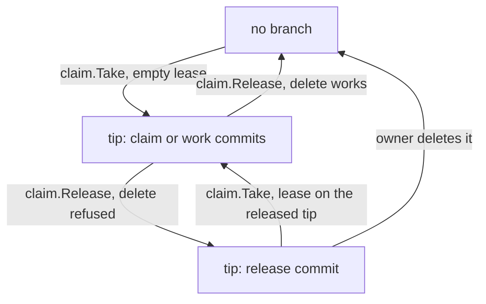

# Claims

How an agent takes a step so no one else does: `furrow claim`, `furrow release` and `furrow claims`.

## Behaviour

A claim is a branch on the remote, named by the config's `branch` pattern (`step/{num}-{step}`,
so FUR-0003.1 is `step/0003-1`). Only `internal/gitx` runs a process, and the process is `git`.

A claim branch whose tip is a **release commit** is released: furrow treats its step as unclaimed,
exactly as if the branch were gone. A release commit changes nothing (its tree is its parent's),
its parent is the branch's tip, and its message is `Release FUR-0004.1`, a blank line, and a
`furrow-release: <16 hex chars>` nonce trailer (`claim.ReleaseTrailer`). Only the tip counts: a
release commit deeper in a branch's history means nothing. A tip is a release commit only when all of
this holds (`claim.IsRelease`): one parent, that parent's tree, the subject `Release <ref>` for
the branch's step, and the trailer, with a 16-hex value, in the message's last paragraph. Every push furrow makes is a
fast-forward or an empty-lease create, so it works where an agent can push commits but can't delete
branches or force-push.

What a branch's tip says, and what each command does with it:

Legend: a box is what the claim branch on the remote looks like; an arrow is the command or person
that moves it there.

**Reading claims.** `claim.List` reads the claim branches with `ls-remote`, fetches them into
`refs/furrow/claims/` (one fetch, and none when there are none), and drops the released ones, so
`furrow next`, `furrow claim`, `furrow status` and the brief see those steps as free. A failed fetch
is `claim.ErrRemote`. `claim.ListAll` returns every claim branch, released ones included, with
`Released` set. `claim.ReadStack` reads the refs `List` fetched.

**`furrow claim <ref>`** fetches base and reads the claims on the remote. It refuses a step that
isn't ready and says why: it's merged, its spec isn't accepted, it's blocked, it waits on named
steps, or someone holds it. It also refuses a step whose `touches` overlap a claimed step, unless
you pass `--force`, and a dirty working tree. Then it makes a claim commit on base. The commit
changes nothing and its message is unique, and furrow pushes it to the new branch with an empty
lease (`--force-with-lease=refs/heads/<branch>:`), so the push only succeeds if the branch doesn't
exist. Exactly one agent wins. The loser exits 3: "FUR-0003.1 is already claimed (step/0003-1).
Run `furrow next` for another step." The winner is switched to the branch, with its upstream set,
unless `--no-checkout`, and furrow prints the PR title `[REF] step title`. `--json` prints
`{"ref", "branch", "sha", "pr_title", "base_branch"}`, where `base_branch` is the branch to open
the PR against: the config's base, or the parent's branch for a stacked claim.

**Claiming a released branch.** When the step's branch exists but is released, `furrow claim` makes
its claim commit on base (or the stack parent's tip) as usual, but with two parents: base first,
the released tip second. Its tree is base's, so the branch starts where a fresh claim would and
`git diff <base>...HEAD` is empty. It pushes with `--force-with-lease=refs/heads/<branch>:<released
tip>`: a fast-forward, and atomic, so of two agents re-claiming the same released branch exactly one
wins and the other exits 3 with the usual "already claimed" message. `claim.ClaimCommit` picks the
newest claim commit, so territory and stacking read the new one.

**Stacking.** With `stack:` above 0 in `.furrow.yml`, `furrow claim` also reads the claim
tips `claim.List` fetched into `refs/furrow/claims/` to see which steps are **handed back** (the claim tip has
the step marked `merged: true`, as `furrow done` writes it). A step that `furrow next` would show
as stacked gets its claim commit on the parent branch's current tip instead of base, with a second
trailer after `furrow-claim:`, `furrow-stack: <parent branch>`. The push is the same empty-lease
push, so one agent wins. It prints `Stacked on step/0090-1. Open the PR against that branch.`
under the first line. A step whose parent stopped being handed back (its branch is gone, or its
tip no longer says `merged: true`) is refused: "FUR-0091.1 waits on FUR-0090.1, which is no longer
handed back. Run furrow next again." A step whose parent has merged is plain ready and is claimed
on base. A stacked step's touches may overlap its parent's chain; overlap with any other claimed
step is refused as before.

**`furrow release <ref> [--json]`** first deletes the claim branch: "Released FUR-0004.1: deleted
step/0004-1 on origin." If the remote refuses the delete while `ls-remote` just answered, it makes
a release commit on the tip `ls-remote` reported and pushes it with
`--force-with-lease=refs/heads/<branch>:<that tip>`: "Released FUR-0004.1: origin wouldn't delete
step/0004-1, so furrow marked it released. Delete the branch when you can; until then furrow treats
it as free." Releasing an unclaimed or already-released step says it isn't claimed ("no
step/0004-1 on origin", or "step/0004-1 on origin is released") and exits 0. An unreachable remote
is `claim.ErrRemote`; a branch that moved before the push (the lease fails) exits 1 with
"step/0004-1 moved while furrow was releasing it. Run furrow release FUR-0004.1 again."; any other
failed release push is wrapped in `claim.ErrRemote`. `--json` prints `{"ref", "branch",
"released", "how"}`, where `how` is `deleted`, `marked` or `""`.

**`furrow claims [--stale 24h] [--json]`** lists every claim with the age of its branch's last
commit. It fetches the claim branches into `refs/furrow/claims/` to read them. A claim is `leftover`
when its step is merged (the branch outlived its PR), `stale` when it has had no commit for longer
than `--stale`, `released` when its tip is a release commit, and `active` otherwise. A released
claim is never `stale` or `leftover`; its line ends `(released: delete the branch when you can)` and
`--json` gives `"state": "released"`. `furrow status` leaves released branches out (they aren't
claims), and a claim stacked on a released branch counts as orphaned. A stacked claim, one whose claim commit has a
`furrow-stack:` trailer, ends `on step/0090-1`, and `--json` adds `"stack_on": "step/0090-1"`. When
that branch is gone from the remote and its step isn't merged, the claim is orphaned: the line ends
`orphaned (step/0090-1 is gone)` and `--json` adds `"orphaned": true`. Release it, or rebase it onto
base.

When the remote can't be reached, the claim functions return `claim.ErrRemote` so callers can say
so and carry on.

## History

- FUR-0003: Claim a step with a branch, atomically (archived 2026-11-03)
