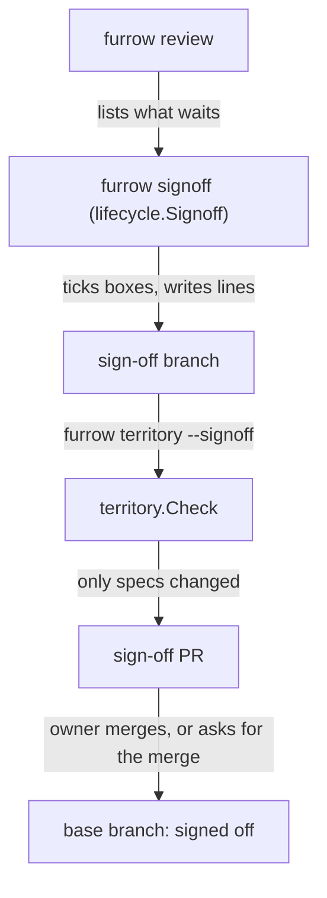

# Lifecycle

How a step is handed back and a spec is finished: `furrow done`, `furrow review`, `furrow signoff` and `furrow archive`.

## Behaviour

**Edits.** Every lifecycle command edits the spec file's text in place. It changes only the line
it means to (the step's `merged:` value, the character inside a criterion's `[ ]`, the `status:`
value) and appends lines to `## Decisions` or the area's `## History`, so comments and formatting
survive. It never changes a criterion's text (INV-4).

**`furrow done <ref>`** sets `merged: true` on one step. It refuses, changing nothing, while any
`after` isn't merged ("FUR-0005.1 is after FUR-0001, which isn't merged. Merge it first.") or a
criterion the step covers, other than a `human:` one, is unticked ("Tick AC-2 with its evidence
first."). Then it says what's next: the `human:` checks now waiting for sign-off, or that the spec
can be archived. On a step that's already merged it says so and changes nothing.

**`furrow review [--json]`** lists every unticked `human:` criterion in `changes/` whose covering
steps are all merged, grouped by spec, with its proof text as what to look at. With none it prints
`Nothing waiting for sign-off.`

**A sign-off is a merged sign-off PR** (INV-3). Anyone, an agent included, can prepare one: run
`furrow signoff` on a branch from the base, then open a PR whose diff is only those ticks and
lines. The sign-off happens when that PR merges into the base branch, merged by the owner or by an
agent the owner asked to, in their own words. Furrow reads only the base branch for what's decided
(`next`, `review` and `lint` run from an up-to-date base), so an unmerged sign-off PR signs off
nothing, and closing it says "not yet".

The flow, from the base branch to a merged sign-off:

Legend: a box is a command, function or branch; an arrow is what passes to the next one, and says
what.

**`furrow signoff <id> <AC-n>... [<id> <AC-n>...]... [--by NAME]`** runs in any session. Each
argument that matches `<prefix>-NNNN` starts a group, and the `AC-n`s after it belong to that
spec: `furrow signoff FUR-0005 AC-8 FUR-0012 AC-5 --by Deven`. The first argument must be a spec
id ("Start with a spec id, such as `furrow signoff FUR-0005 AC-8`."), a spec id with nothing after
it is refused ("Name at least one criterion after FUR-0012."), and naming a spec twice merges its
groups. Every criterion in every group is checked first, and each must be one `review` lists
(`FUR-0012 has no AC-9.`, `AC-2 isn't a human: criterion…`, `AC-5 is already ticked.`,
`… isn't waiting for sign-off: …`). Every refusal is reported, one per line, and if there is any,
no file changes. Then it ticks each box and appends `- YYYY-MM-DD: AC-n signed off by NAME.` to
`## Decisions`, in AC order, and prints one line per spec in the order given
(`Signed off AC-8 on FUR-0005 by Deven.`), archiving each spec it completes and saying so.

`--by NAME` names the person who checked, never the agent. Outside an agent session, a missing
`--by` falls back to `git config user.name` in the repo, read through `internal/gitx`. Inside one
(`CLAUDECODE` or `FURROW_AGENT` set), there is no fallback, because the session's git identity may
be the agent's: a missing `--by` is refused with "Say who checked it: --by NAME." before git is
run. With neither a name nor `--by`, it refuses the same way.

**`furrow territory --signoff [--base REF] [--json]`** checks a sign-off PR's diff instead of a
step's. It passes when every changed path is under the specs folder's `changes/`, `archive/` or
`areas/`, and fails otherwise with exit 1, printing "A sign-off PR changes only specs. Move <path>
to its own PR." for each path outside them. It needs no step and ignores the branch name.
`--signoff` with `--step` or `--body-file` is a usage error (exit 2). `--json` uses the step
report's shape, with `"step": ""`.

**`furrow archive <id>`** refuses, naming the unmerged steps and unticked boxes, unless the spec is
complete. Then it sets `status: done`, moves the file from `changes/` to `archive/` with the same
name, appends `- <id>: <title> (archived YYYY-MM-DD)` to the area's `## History`, and reminds you
that the area's `## Behaviour` should already say what the spec changed.

Dates come from an injected clock.

## History

- FUR-0010: furrow signoff takes the name from git when --by is left out (archived 2026-11-03)
- FUR-0005: Hand back steps, sign off what a person must judge, archive finished specs (archived 2026-11-03)
- FUR-0015: Sign off from anywhere: merging a sign-off PR is the sign-off (archived 2026-11-03)
