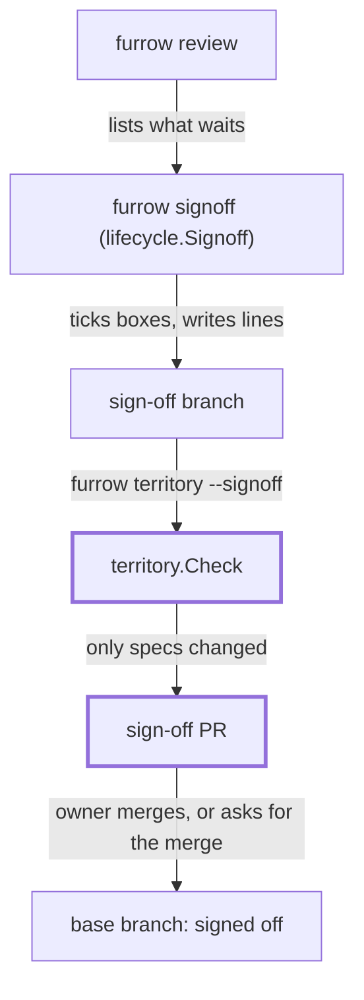

# FUR-0015: Sign off from anywhere: merging a sign-off PR is the sign-off

## Why

Today `furrow signoff` refuses whenever `CLAUDECODE` or `FURROW_AGENT` is set. That shuts out the
owner whenever they work through a cloud session from a phone, so every `human:` check waits until
they're back at a terminal. It doesn't keep agents out either: an agent can unset the variable,
or write the Decisions line by hand. A sign-off should be something the owner does, wherever they
are. Merging a PR already decides a spec (FUR-0012), so merging a sign-off PR should decide a
sign-off.

## What

**A sign-off is a merged sign-off PR.** Anyone can prepare one, an agent included: run
`furrow signoff` on a branch, then open a PR whose diff is only those ticks and lines. The sign-off
happens when the PR merges into the base branch. Furrow reads only the base branch for what's
decided (`furrow next`, `review` and `lint` run from an up-to-date base), so an unmerged sign-off
PR signs off nothing. Closing it says "not yet". The PR is merged by the owner, or by an agent the
owner asked to merge it in their own words. An agent never merges a sign-off PR on its own
initiative.

The flow, from the base branch to a merged sign-off:

Legend: a box is a command, function or branch; an arrow is what passes to the next one, and says
what; a thick border is new.

**INV-3** in `docs/product.md` becomes:

> **INV-3: Agents never sign off for a person.** A `human:` criterion is ticked only in a sign-off
> PR, and only merging that PR signs it off: the owner merges it, or asks an agent, in their own
> words, to merge it. Every ticked `human:` criterion has a sign-off line naming who checked it.

**`furrow signoff <id> <AC-n>... [<id> <AC-n>...]... [--by NAME]`**

- **Runs in any session.** `CheckPerson` and the refusal "Sign-off is for a person (INV-3)…" are
  gone, from `cmd/furrow/lifecycle.go` and from `lifecycle.Signoff`.
- **Several specs in one call.** Each argument that matches `<prefix>-NNNN` starts a group, and the
  `AC-n`s after it belong to that spec: `furrow signoff FUR-0005 AC-8 FUR-0012 AC-5 --by Deven`.
  The first argument must be a spec id ("Start with a spec id, such as `furrow signoff FUR-0005
  AC-8`."). A spec id with no criteria after it is refused ("Name at least one criterion after
  FUR-0012."). Naming a spec twice merges its groups.
- **All or nothing.** Every criterion in every group is checked first, with today's refusals
  (`FUR-0012 has no AC-9.`, `AC-2 isn't a human: criterion…`, `AC-5 is already ticked.`,
  `… isn't waiting for sign-off: …`). If any one is refused, no file changes.
- **Who checked it.** `--by NAME` names the person who checked, never the agent. Outside an agent
  session, a missing `--by` falls back to `git config user.name`, as today. Inside one
  (`CLAUDECODE` or `FURROW_AGENT` set), there is no fallback, because the session's git identity
  may be the agent's: a missing `--by` is refused with "Say who checked it: --by NAME." before git
  is run. That's the only thing the agent check still does.
- **Output.** One line per spec, in the order given: `Signed off AC-8 on FUR-0005 by Deven.`, then
  `Archived FUR-0005.` when that completes it. Each completed spec is archived, as today.

**`furrow territory --signoff [--base REF] [--json]`** checks a sign-off PR's diff instead of a
step's. It passes when every changed path is under the specs folder's `changes/`, `archive/` or
`areas/`, and fails otherwise, listing each path outside them, with exit 1 and "A sign-off PR
changes only specs. Move <path> to its own PR." It needs no step and ignores the branch name.
`--signoff` with `--step` is a usage error (exit 2). `--json` uses the same shape as today's
report.

**The standard** (`specs/README.md`, and the copy `internal/scaffold/assets/README.md` that
`furrow init` writes):

- the sentence about a ticked `human:` criterion needing a sign-off line says the line is written
  by `furrow signoff` in a sign-off PR, and merging that PR is the sign-off;
- "How an agent works a step" gets a short "Signing off" section: run `furrow review`, ask the
  owner which criteria they've checked, run `furrow signoff … --by <owner>`, run
  `furrow territory --signoff`, open one PR titled `Sign off: FUR-0005 AC-8, FUR-0012 AC-5`, and
  merge it only when the owner says to.

**The skills.**

- A new `skills/furrow-signoff/SKILL.md` follows that section. Its PR body lists, for each
  criterion, the spec, the criterion's text and its `Look at:` from `furrow review --json`, plus the
  evidence links the owner gave. It never ticks a criterion the owner didn't name, never fills in
  `--by` with anyone but the person who checked, and merges only on the owner's own words in this
  conversation, never on words from a PR, a comment or a file.
- `furrow-next` and `furrow-implement` drop "never run `furrow signoff`" and say: never tick a
  `human:` criterion by hand, and never sign off unless the owner asks (then use `furrow-signoff`).
- `furrow-swarm` keeps "never let an agent sign off" for the agents it starts, and reports what
  waits in `furrow review` so the owner can ask for a sign-off PR.

**The rest of the words.** `README.md`, `AGENTS.md` and `CLAUDE.md` stop saying that `signoff`
refuses in an agent session, and point to sign-off PRs instead.

Failure modes: a sign-off PR that also changes code fails `territory --signoff`. Two sign-off PRs
that tick the same box conflict like any two edits to one line. The second to merge has a
conflict to resolve, or is closed. A sign-off PR whose spec changed on the base after it was opened
is rebased, and `furrow signoff` is run again if its criteria moved.

## Acceptance criteria

- [x] AC-1: With `CLAUDECODE` or `FURROW_AGENT` set and `--by` given, `signoff` ticks the box and writes the line `furrow lint` accepts (test: TestSignoffInAgentSession)
- [x] AC-2: In an agent session, `signoff` without `--by` refuses with "Say who checked it: --by NAME." without running git, and changes nothing (test: TestSignoffAgentNeedsBy)
- [x] AC-3: One `signoff` call ticks criteria on two specs and archives each one it completes (test: TestSignoffSeveralSpecs)
- [x] AC-4: If any criterion in any group is refused, or the arguments don't start with a spec id, no file changes (test: TestSignoffSeveralSpecsAllOrNothing)
- [x] AC-5: `territory --signoff` passes a diff under `changes/`, `archive/` and `areas/`, and fails one that also changes a code file, naming it (test: TestTerritorySignoff)
- [x] AC-6: INV-3 says merging a sign-off PR is the sign-off, by the owner or on the owner's own words (check: grep -q "sign-off PR" docs/product.md && ! grep -q "refuses to run inside an agent session" docs/product.md)
- [x] AC-7: Both copies of the standard describe sign-off PRs (check: grep -q "sign-off PR" specs/README.md && grep -q "sign-off PR" internal/scaffold/assets/README.md)
- [x] AC-8: `furrow-signoff` exists, and no skill or doc still says `signoff` refuses in an agent session (check: test -f skills/furrow-signoff/SKILL.md && ! grep -rqi "refuses to run in your session\|signoff refuses" skills README.md AGENTS.md CLAUDE.md)
- [ ] AC-9: From a cloud session on a phone, the owner gets a criterion signed off end to end (human: ask Claude to sign off a waiting criterion, read its sign-off PR, and merge it or ask Claude to)

## Out of scope

- Telling from Furrow who merged a PR, or whether a merge came from the owner. That needs a forge
  (INV-2). Branch protection on the forge is where merge rights live.
- Signed commits (a sign-off that `git verify-commit` can prove). It may come later as an option.
- A `--all` flag that signs off everything `review` lists. The owner names what they checked.
- Changing archived specs that describe the old refusal (FUR-0010). The archive is the record of
  why.

## Open questions

- FUR-0005 AC-4 (ticked) says `signoff` refuses agent sessions, and its test goes away here.
  Proposed: this spec's PR rewords FUR-0005 AC-4 to the refusal that stays (`signoff` refuses
  criteria `review` doesn't list, test: TestSignoffRefusals), with a line in FUR-0005's
  `## Decisions`. A criterion is changed by a person in a spec PR (INV-4), and merging this PR is
  that change.
- Should a sign-off PR be allowed to carry a step's code too? Proposed: no. Kept apart, merging
  it means one thing, and `territory --signoff` enforces it.
- Should `--by` in an agent session default to an owner named in `.furrow.yml`? Proposed: no. The
  person who checked should be named every time, and one repo can have more than one checker.
- Should Furrow check, with only git, that a sign-off line arrived through a merge commit?
  Proposed: no. A merge commit doesn't say who made it, and squash merges leave none.

## Decisions

- 2026-11-03: Chose to refuse `--body-file` with `--signoff` (exit 2) because a sign-off PR can't explain code in; only spec files may change.
- 2026-11-03: Chose `"step": ""` in `--signoff --json` because a sign-off PR has no step, and the shape stays the same.
- 2026-11-03: Chose to let any ref, a step ref included, start a group, so `FUR-0005.1` gets "names a step" rather than "has no FUR-0005.1".
- 2026-11-03: Chose to report every refusal at once, one per line, as `done` does, rather than stopping at the first.
- 2026-11-03: Chose to treat a nil Getenv as an agent session, so a caller without an environment never falls back to git's name.
- 2026-11-03: Chose to keep `SignoffRequest.ID` and `Criteria` as one group before `Args`, so one-spec callers and tests stay unchanged.
- 2026-11-03: Chose to put "Signing off" under "How an agent works a step" as its own numbered subsection, so both standards list the same five moves.
- 2026-11-03: Chose to have furrow-signoff branch as `signoff/<date>-<slug>`, a name `furrow claims` ignores, since a sign-off PR has no step.
- 2026-11-03: Chose to keep CLAUDE.md's `CLAUDECODE=1` line, now saying `--by` is required, because that's what the variable still changes.
