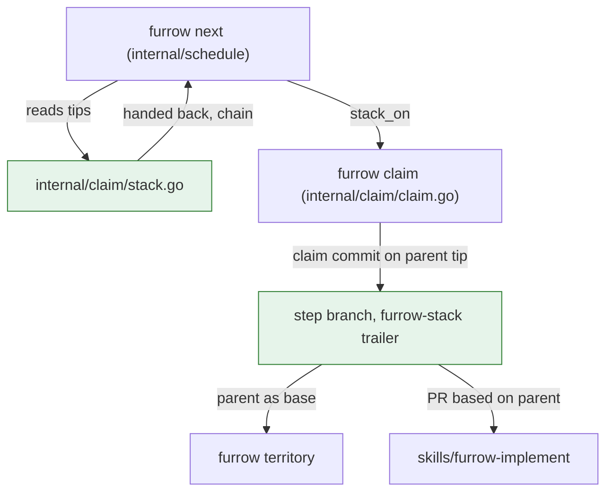

# FUR-0017: Stacked steps: start a step on top of one waiting for review

## Why

Today a step that comes `after` another can't start until that step's PR is merged. So while the
owner is away, the swarm runs dry, and when they come back there's one PR to review at a time. With
stacking, a step can start on top of a step that's been handed back and is waiting for review. The
owner comes back to a stack of PRs and reviews them bottom up, the way GitHub's stacked pull
requests show them.

## What

Stacking is off unless `.furrow.yml` turns it on:

```yaml
stack: 3   # how many unmerged steps a new step may sit on. 0, or the key left out, is off.
```

A value that isn't a whole number from 0 to 9 fails config loading:
`.furrow.yml: stack must be a whole number from 0 to 9, got "yes"`.

### Handed back

A claimed step is **handed back** when its claim branch's tip has the step's spec file with
`merged: true` on that step. That's what `furrow done` writes, so a step is handed back from the
moment its PR is ready. Furrow reads it with git alone: it fetches the claim branches into
`refs/furrow/claims/` (as `furrow claims` does) and reads the spec file at each tip with
`git show <sha>:<path>`. A claim whose tip has no spec file, or one that doesn't parse, isn't handed
back.

### When a step can stack

With `stack: N` (N > 0), a step whose `after` isn't all merged is **ready, stacked** instead of
**waiting** when every one of these holds:

1. every unmerged step it waits on is handed back;
2. those steps sit on one chain: each one is the stack parent of the next, or the same step, so
   there's a single top step, the **parent**, whose branch holds all of them;
3. the parent's chain, counting the parent, is at most N unmerged steps long;
4. it isn't blocked or claimed.

The parent's chain is the parent, then the step the parent's claim is stacked on (read from its
claim commit, below), and so on until a step that isn't stacked.

```
FUR-0090.1  handed back, on main
FUR-0091.1  after [FUR-0090.1]          → ready, stacked on step/0090-1 (depth 1)
FUR-0092.1  after [FUR-0091.1]          → waiting until 0091.1 is handed back, then depth 2
FUR-0093.1  after [FUR-0090.1, FUR-0095.1], 0095.1 handed back on main
                                        → waiting: FUR-0090.1 and FUR-0095.1 are on different stacks
```

A stacked step's `touches` may overlap its parent's chain: it's built on top of them, not beside
them. Overlap with any other claimed step, or with a step already in the together set, holds it
as before.

### `furrow next` and `furrow graph`

- A stacked ready step prints its parent: `FUR-0091.1  stacked on step/0090-1 (FUR-0090.1)`.
  `--json` adds `"stack_on": {"ref": "FUR-0090.1", "branch": "step/0090-1"}` and `"depth": 1`;
  an unstacked step has `"stack_on": null` and `"depth": 0`.
- **Ranking.** Plain ready steps rank before stacked ones, then the order is as today. A free agent
  takes work that can't be thrown away first.
- A waiting step that can't stack says why, after what it waits on: `(FUR-0090.1 isn't handed
  back)`, `(on different stacks: FUR-0090.1, FUR-0095.1)`, or `(the stack would be 4 deep, over
  stack: 3)`.
- `--offline`, or an unreachable remote, can't read the claim tips, so nothing stacks and the
  usual note says claims weren't checked.
- With `stack: 0` the output and JSON are byte for byte what they are today, apart from the two new
  JSON keys.
- `furrow graph` puts a stacked step in the same wave it's in today. Its state reads
  `ready (stacked)`.

### `furrow claim`

Claiming a stacked step makes its claim commit on the tip of the parent's branch instead of base,
with a second trailer naming the parent:

```
Claim FUR-0091.1: Your line: start the next one through trust

furrow-claim: 3f9a2c41b7d0e5a6
furrow-stack: step/0090-1
```

The push is the same empty-lease push, so claiming stays atomic (INV-5). The output adds what the
agent needs to open the PR: `Stacked on step/0090-1. Open the PR against that branch.` and
`--json` adds `"base_branch": "step/0090-1"` (or the config's base for an unstacked claim).

If the parent's branch moved between `next` and `claim`, the claim builds on the new tip. If the
parent stopped being handed back (its branch is gone, or its tip no longer says `merged: true`),
the claim is refused: `FUR-0091.1 waits on FUR-0090.1, which is no longer handed back. Run
furrow next again.` If the parent merged in the meantime, the step is plain ready and is claimed on
base as usual.

`furrow claims` shows a stacked claim's parent: `step/0091-1  FUR-0091.1  active  2h  on step/0090-1`,
and `"stack_on": "step/0090-1"` in `--json`.

### `furrow territory`

With no `--base`, territory finds the step's claim commit (the first commit on `HEAD` whose message
has `furrow-claim:` and starts `Claim <REF>:`). If it has a `furrow-stack:` trailer and that branch
is on the remote and not merged, the base is `<remote>/<parent branch>`. Otherwise it's
`<remote>/<base>`, as today. The report's first line names it:
`FUR-0091.1 (stacked on step/0090-1): 9 files inside its territory.` `--base` still wins, so CI,
which passes the PR's base branch, is unchanged.

### The skills

- **furrow-next / furrow-implement**: when `claim` says `Stacked on <branch>`, open the draft PR with
  that branch as its base. If `gh stack` is installed, link the stack with `gh stack link`;
  otherwise the chained bases are the stack. Run `furrow done` and push it *before* marking the PR
  ready, never after: until then the step isn't handed back, and nothing can stack on it. If the
  parent changes after review, rebase onto it (`git rebase origin/<parent>`) and push with
  `--force-with-lease`, unless GitHub's stack has already rebased it.
- **furrow-swarm**: is the skill to use whenever the owner asks to build, to work through the queue,
  or to work in parallel. With stacking on, when a step is handed back it asks `furrow next` again
  and starts what stacked on it. When it reports back, it lists each stack bottom to top, and says
  the owner reviews from the bottom and can merge a whole stack from its top PR.
- **furrow-verify**: checks that a stacked step's PR is based on its parent's branch.

### How a stack flows

What happens to a step from claim to merge when it stacks on another.



Legend: a box is a command, file or branch; an arrow is what one hands the next, as labelled;
green is new.

### Failure modes

- **The parent's PR is closed without merging.** Its branch is deleted, so the child's claim is
  stacked on nothing. `furrow next` lists the child as claimed, and `furrow claims` marks it
  `orphaned (step/0090-1 is gone)`. The agent releases it or rebases it onto base.
- **The parent is squash-merged and the child isn't rebased.** The child's diff against base still
  shows the parent's files. GitHub's stack rebases it for you. Without that, `furrow territory`
  reports the parent's files as outside, which is the signal to `git rebase --onto origin/main
  <old parent tip>`.
- **No network.** Nothing stacks; `next` says claims weren't checked, as today.

## Acceptance criteria

- [x] AC-1: `stack: N` in `.furrow.yml` is read; a missing key is 0, and a value that isn't a whole number from 0 to 9 fails with the message above. (test: TestConfigStack)
- [x] AC-2: A claimed step is handed back exactly when its claim branch's tip has the step marked `merged: true`; a tip without the spec file, or with `merged: false`, isn't. (test: TestHandedBack)
- [x] AC-3: With `stack: 3`, a step after one handed-back step is ready and stacked on that step's branch at depth 1; after a handed-back step that is itself stacked, depth 2; and a step that would be 4 deep is waiting with "over stack: 3". (test: TestStackDepth)
- [x] AC-4: A step after two handed-back steps on different stacks is waiting with "on different stacks"; after two on the same chain it stacks on the top one. (test: TestStackOneChain)
- [x] AC-5: A stacked step whose touches overlap its parent's chain isn't held for it, but is held for an overlap with any other claimed step; and plain ready steps rank before stacked ones. (test: TestStackOverlapAndRank)
- [x] AC-6: `furrow next` and `--json` show `stack_on` and `depth`; with `stack: 0` the text output is unchanged from before this spec on the same repo, and `--offline` stacks nothing. (test: TestNextStack)
- [ ] AC-7: Claiming a stacked step pushes a claim commit whose parent is the parent branch's tip and whose message has `furrow-stack: <branch>`, and prints "Stacked on <branch>. Open the PR against that branch." with `base_branch` in `--json`. (test: TestClaimStacked)
- [ ] AC-8: Two agents claiming the same stacked step at once: exactly one wins, the other exits 3. (test: TestClaimStackedRace)
- [ ] AC-9: Claiming a stacked step whose parent is no longer handed back is refused with the message above; if the parent merged, it's claimed on base. (test: TestClaimStackParentGone)
- [ ] AC-10: `furrow claims` shows a stacked claim's parent, and marks it orphaned when the parent's branch is gone and the parent isn't merged. (test: TestClaimsStackOn)
- [ ] AC-11: With no `--base`, `furrow territory` on a stacked step diffs against the parent's branch and names it in the first line; once the parent's branch is gone it diffs against base; `--base` wins. (test: TestTerritoryStackBase)
- [ ] AC-12: The furrow-implement and furrow-next skills say to open a stacked step's PR against its parent's branch, to link it with `gh stack link` when `gh stack` is there, and to run `furrow done` before marking the PR ready. (check: grep -q "gh stack link" skills/furrow-implement/SKILL.md && grep -qi "before marking the PR ready" skills/furrow-implement/SKILL.md && grep -q "Stacked on" skills/furrow-next/SKILL.md)
- [ ] AC-13: furrow-swarm's description names building, working through the queue and working in parallel as when to use it, and its steps start stacked work as steps are handed back and report stacks bottom to top. (check: grep -qi "work in parallel" skills/furrow-swarm/SKILL.md && grep -qi "bottom" skills/furrow-swarm/SKILL.md)
- [ ] AC-14: furrow-verify checks a stacked step's PR is based on its parent's branch. (check: grep -qi "parent's branch" skills/furrow-verify/SKILL.md)
- [ ] AC-15: `specs/README.md` documents `stack:` and handed back, and the agents area describes stacked PRs in present tense. (check: grep -q "stack:" specs/README.md && grep -qi "handed back" specs/README.md && grep -qi "stack" specs/areas/agents.md)
- [ ] AC-16: In a real repo with `stack: 2`, a swarm stacks a step on a handed-back one, opens it as a PR based on the parent's branch, and the owner can review and merge the pair from GitHub. (human: open the two PRs, check the second is based on the first and shows as stacked, merge them and see main has both)

## Out of scope

- Calling GitHub, or any forge, from the binary. Furrow reads branches with git; linking PRs into
  a GitHub stack is the skill's job, with `gh stack` or the forge's tools (INV-2, INV-7).
- Rebasing anything for the agent. Furrow says where to build; git or GitHub keeps the stack
  rebased.
- Stacking on a step that's claimed but not handed back, or trees of stacks (one parent per step).
- Working out "merged" from git instead of the `merged:` line. That's its own spec.
- Stacking a step on one it doesn't come `after`, just because their touches overlap.

## Open questions

- Should a step stack only on steps that are handed back, not on ones still being built?
  Proposed: only handed back. A step still being built can change under the one on top of it, and
  `furrow done` is a clear moment that git can see.
- Should stacking be off by default? Proposed: yes, `stack: 0`. A repo opts in, so nothing changes
  for repos that haven't, and the owner picks how deep a review queue they want.
- Should plain ready steps rank before stacked ones? Proposed: yes. Work on main can't be thrown
  away if a parent's review goes badly; stacked work can.
- Should stacks be single chains only? Proposed: yes. GitHub's stacked pull requests are a chain,
  and each PR has one base.

## Decisions

- 2026-11-04: Chose to read the stack size in `schedule.Build` from `repo.Config.Stack`, and to stack only when claims were checked and each `schedule.Claim` carries `HandedBack` and `StackOn` (set by `claim.ReadStack`), because that keeps the schedule free of git and leaves `furrow claim`'s plan unchanged until step 2 reads the tips too.
- 2026-11-04: Chose to print a stacked step's parent as a third line under it in `Ready to start:`, `  FUR-0091.1  stacked on step/0090-1 (FUR-0090.1)`, because the first two lines keep today's layout and the spec's line starts with the ref.
- 2026-11-04: Chose to name every wait that isn't handed back in the waiting reason (`FUR-0090.1, FUR-0095.1 aren't handed back` for two), to list every step it waits on after "on different stacks:", and to check the three rules in the spec's order, so the first rule that fails is the one reported.
- 2026-11-04: Chose to add `why_waiting` to a waiting step's `--json`, left out when empty, because INV-6 says agents never parse prose; with `stack: 0` it never appears, so the JSON there differs only by `stack_on` and `depth`.
- 2026-11-04: Chose to make `furrow graph --json` say `"state": "ready (stacked)"` like its text, and to widen graph's state column only when a label is longer than `[waiting]`, so `stack: 0` prints exactly as before.
- 2026-11-04: Chose to find a claim commit as the newest commit in the tip's history whose message starts `Claim <REF>:` and has a `furrow-claim:` line, because a stacked branch also holds its parent's claim commit, and a re-claim's own commit is the newest.
- 2026-11-04: Chose to count a stacked chain only through steps that are unmerged and still have a claim branch, so a parent that merged or whose branch is gone ends the chain.

## Notes for the agent

- `furrow claims` already fetches claim branches into `refs/furrow/claims/`; reuse that in
  `internal/claim/stack.go` rather than adding a second way.
- `spec.ParseSpec` reads a spec from bytes, so a tip's copy can be parsed without checking it out.
- CI already passes `--base origin/$BASE_REF`, and a stacked PR's base is the parent's branch, so
  CI's territory check needs no change.
- GitHub's docs: "About stacked pull requests" and "Stacked pull requests CLI commands" on
  docs.github.com. A stack is a chain of PRs where each targets the branch below it; merging a lower
  PR rebases the rest onto the base.
