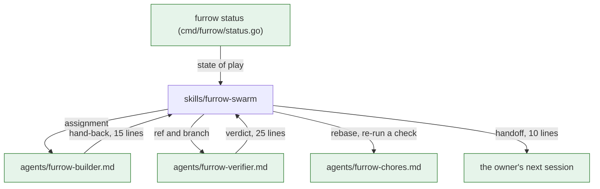

# FUR-0018: Lean orchestrator sessions: small hand-backs, fresh verifiers, one-call status

## Why

A swarm's orchestrator session grows to 400–700K tokens, and every later model call re-reads all of
it, so most of a swarm's cost is the orchestrator re-reading its own history. The history fills up
with agents' raw command output and with the verifications it runs itself, and the session keeps
running across waves because starting a new one means rebuilding the state of play by hand. This
spec keeps the orchestrator small: agents report back in a few lines, verification runs in a fresh
agent, and one command gives a new session the whole state.

## What

### How a step flows through a swarm

Where each step's detail lives, and what reaches the orchestrator.



Legend: a box is a command, skill, agent or session; an arrow is what one hands the next, as
labelled; green is new.

### The hand-back (furrow-swarm)

The brief furrow-swarm gives each builder ends with this report contract, replacing today's list
("claim output, files changed, tests and results, `furrow territory` and `furrow lint` output…"):

```
FUR-0018.2  PR #51  step/0018-2  handed back
claim: exit 0
make check: exit 0
furrow territory: exit 0
furrow lint: exit 0
furrow done: pushed
decisions: chose internal/status over cmd-only, so the text and JSON share one model
spec problem: none
```

At most 15 lines. Raw output only for a command that failed, at most 20 lines of it.

### Verification in a fresh agent (furrow-swarm, furrow-verify)

When a builder hands back, the orchestrator doesn't run `furrow-verify` itself. It starts a fresh
`furrow-verifier` agent with the ref, the branch and the PR number, and reads only its verdict.
A fresh reviewer is also less anchored on the builder's claims. On "ready to merge: yes" the
orchestrator merges as today; on "no" it sends the findings back to the builder.

`furrow-verify` adds: run as a sub-agent, the report is the verdict table, the findings and one
line `ready to merge: yes` or `ready to merge: no`, at most 25 lines in all.

### Chores (furrow-swarm)

Rebasing a stacked step onto a parent that changed, merging the base into a step branch with a
conflict only in `specs/`, re-running the repo's check, and reading a CI failure go to a
`furrow-chores` agent. It reports at most 10 lines. A conflict outside `specs/`, or a failure it
can't explain, goes back to the step's builder.

### Hand off and stop (furrow-swarm)

The orchestrator stops, instead of carrying on into the next wave, when any of these holds:

- a wave has merged and `furrow next` offers new work (so the next wave starts in a fresh session);
- nothing can start until the owner acts (review, sign-off, a spec to merge);
- the conversation is over about 200K tokens, when the tool shows it.

It then writes a handoff of at most 10 lines, holding only what the repo doesn't: questions put to
the owner in chat and not yet answered, and anything blocked outside Furrow (a secret, a sign-in, a
broken tool). It ends with the line to start the next session:

```
Start a new session with: Run furrow status, then furrow-swarm.
```

The "Stop when" report to the owner stays as it is, after the handoff.

### `furrow status`

```
furrow status [--json] [--offline]
```

One call that says where everything stands, built from the specs and the remote's branches, as
`furrow next`, `furrow claims` and `furrow review` are. Sections print in this order, each sorted by
ref, and an empty section prints `(none)`:

```
In progress (1):
  FUR-0018.2  step/0018-2  active  2h
Handed back, waiting for review (2):
  FUR-0018.3  step/0018-3  on main
  FUR-0019.1  step/0019-1  on step/0018-3
Ready now (7):
  FUR-0020.1  The thing
  FUR-0020.2  The other thing  stacked on step/0019-1 (FUR-0019.1)
  ... at most 5, ranked as furrow next ranks them
  +2 more: furrow next
Waiting on the owner:
  human checks: 4 (furrow review)
  ready to archive: FUR-0017
Stale or leftover claims: 1 (furrow claims)
Next: Run furrow next --agents N for the 7 ready steps.
```

The `Next:` line is the first of these that applies:

1. stale or leftover claims: `Next: Run furrow claims, then furrow release what's left over.`
2. ready steps: `Next: Run furrow next --agents N for the <n> ready steps.`
3. handed-back steps: `Next: Review the handed-back PRs, the bottom of each stack first.`
4. human checks: `Next: Check what furrow review lists, then ask for a sign-off PR.`
5. otherwise: `Next: Nothing to do. Write a spec with furrow-write.`

`--json` prints the same facts:

```json
{
  "claims_checked": true,
  "in_progress": [{"ref": "FUR-0018.2", "branch": "step/0018-2", "state": "active", "age": "2h"}],
  "handed_back": [{"ref": "FUR-0018.3", "branch": "step/0018-3", "stack_on": null}],
  "ready": [{"ref": "FUR-0020.1", "title": "The thing", "stack_on": null}],
  "ready_total": 7,
  "human_checks": 4,
  "ready_to_archive": ["FUR-0017"],
  "leftover_claims": 1,
  "next": "Run furrow next --agents N for the 7 ready steps."
}
```

`ready` in JSON lists every ready step, not only 5. Ages come from the injected clock.

**Failure modes.**

- `--offline`, or a remote that can't be reached: the three claim sections print
  `(remote not checked)`, `ready` is worked out as `furrow next --offline` does, `claims_checked`
  is false, and the exit code is 0. The `Next:` rules skip what wasn't checked.
- No `.furrow.yml`, or a spec that doesn't parse: the same error and exit code as `furrow next`.
- It runs only `git`, through `internal/gitx` (INV-2, INV-7), and never asks a forge for PR or CI
  state.

### The plugin's agents

The plugin ships three agent definitions in `agents/`, which Claude Code finds at a plugin's root.
`.claude/agents` links to `../agents`, so Furrow's own sessions use them, as `.claude/skills`
does for the skills.

| Agent | Does | Model | Returns |
| --- | --- | --- | --- |
| `furrow-builder` | claims and builds one step with `furrow-next` and `furrow-implement`, in the worktree it's given | no `model:` line: the session's model | the 15-line hand-back |
| `furrow-verifier` | runs `furrow-verify` on the ref and branch it's given | no `model:` line: the session's model | the 25-line verdict |
| `furrow-chores` | the chores above | `model: sonnet` | at most 10 lines |

Each file has `name`, `description` and the frontmatter Claude Code reads. Each body repeats the
rules from furrow-swarm's brief that agent needs: never tick a `human:` box, never sign off, never
edit a criterion's text, work only in its worktree. A project overrides a model by copying an
agent into its own `.claude/agents/` and editing it.

## Acceptance criteria

- [x] AC-1: furrow-swarm's builder brief ends with the hand-back contract: at most 15 lines, each command with its exit code, decisions one line each, a spec problem or "none", and raw output only for a failure, at most 20 lines. (check: grep -q "At most 15 lines" skills/furrow-swarm/SKILL.md)
- [x] AC-2: furrow-swarm verifies each hand-back in a fresh `furrow-verifier` agent, never in the orchestrator itself, and merges on its `ready to merge: yes`. (check: grep -q "furrow-verifier" skills/furrow-swarm/SKILL.md)
- [x] AC-3: furrow-verify says that run as a sub-agent its report is the verdict table, the findings and a `ready to merge:` line, at most 25 lines. (check: grep -q "ready to merge:" skills/furrow-verify/SKILL.md)
- [x] AC-4: furrow-swarm sends the chores listed in this spec to `furrow-chores` and anything else back to the builder. (check: grep -q "furrow-chores" skills/furrow-swarm/SKILL.md)
- [x] AC-5: furrow-swarm stops at a wave boundary, when nothing can start until the owner acts, or past about 200K tokens, with a handoff of at most 10 lines that ends `Start a new session with: Run furrow status, then furrow-swarm.` (check: grep -q "Run furrow status, then furrow-swarm" skills/furrow-swarm/SKILL.md)
- [x] AC-6: `furrow status` prints In progress, Handed back, Ready now, Waiting on the owner, Stale or leftover claims and Next, in that order, each sorted by ref, with `(none)` for an empty section. (test: TestStatusText)
- [x] AC-7: Ready now shows at most 5 steps, ranked as `furrow next` ranks them, then `+N more: furrow next`; `--json`'s `ready` lists them all and `ready_total` counts them. (test: TestStatusReadyCap)
- [x] AC-8: The `Next:` line is the first of the five rules that applies. (test: TestStatusNextLine)
- [x] AC-9: `--json` prints the keys in this spec with the same facts as the text, and two runs on the same repo and clock print the same bytes. (test: TestStatusJSON)
- [x] AC-10: With `--offline` or an unreachable remote, the claim sections say `(remote not checked)`, `claims_checked` is false, ready matches `furrow next --offline`, and it exits 0. (test: TestStatusOffline)
- [x] AC-11: On Furrow's own repo, `furrow status --offline` prints at most 40 lines. (check: test "$(go run ./cmd/furrow status --offline | wc -l)" -le 40)
- [x] AC-12: `agents/furrow-builder.md` and `agents/furrow-verifier.md` exist, have no `model:` line, and each says what it returns and repeats the never-sign-off rules. (check: test -f agents/furrow-builder.md && test -f agents/furrow-verifier.md && ! grep -q "^model:" agents/furrow-builder.md agents/furrow-verifier.md)
- [x] AC-13: `agents/furrow-chores.md` exists with `model: sonnet` and says it returns at most 10 lines. (check: grep -q "^model: sonnet" agents/furrow-chores.md)
- [x] AC-14: `.claude/agents` is a link to `../agents`. (check: test "$(readlink .claude/agents)" = ../agents)
- [ ] AC-15: In one real swarm wave, each hand-back and each verdict the orchestrator received kept to its line limit, and the orchestrator stopped with a handoff a fresh session could start from. (human: the orchestrator's transcript of one wave, and the next session started from its handoff line)

## Out of scope

- Measuring or reporting tokens or cost. Furrow can't see them, and skills say what to do, not what it cost.
- Reading a forge's API for PR or CI state in `furrow status` (INV-2).
- Changing furrow-next, furrow-implement, furrow-write or furrow-signoff, beyond what the builder agent's body says.
- Changing how Claude Code watches PRs. The handoff doesn't unsubscribe anything.
- Updating Fetch's and Edition's copies of the skills. That follows a release, in those repos.
- Choosing models for Fetch or Edition. They override the plugin's agents in their own repos.

## Open questions

- Should builders of `size: s` steps run on Sonnet to save more? Proposed: No. Builders and the verifier use the session's model, so quality holds; only chores default to Sonnet, and a project can override any agent.
- When should the swarm hand off? Proposed: at each wave boundary, when nothing can start until the owner acts, or past about 200K tokens, as in What.
- How many ready steps should `furrow status` show? Proposed: 5, with `+N more: furrow next`, so the output stays under 40 lines.

## Decisions

- 2026-11-04: Chose to list a stale claim under In progress and also count it in Stale or leftover claims, because it is still someone's unfinished step.
- 2026-11-04: Chose to count claims on merged or unknown steps, and orphaned stacked claims, as leftover, matching furrow claims' leftover and orphaned states.
- 2026-11-04: Chose to print a section header with its count only when non-empty, and an empty Waiting on the owner as `(none)`, omitting zero lines.
- 2026-11-04: Chose to copy furrow claims' age format into internal/status rather than export it, so this step stays inside its touches.
- 2026-11-04: Chose to leave `tools:` out of all three agents, so each inherits the session's tools, including the forge MCP tools a builder needs for its PR.
- 2026-11-04: Chose to leave plugin.json unchanged: Claude Code finds `agents/` at a plugin's root by default, as the spec says.
- 2026-11-04: Chose to have furrow-swarm start the shipped agents by name and keep only the hand-back contract in the brief, since each agent's body repeats the rules.
- 2026-11-04: Chose to fold furrow status into specs/areas/scheduling.md in this last step, as FUR-0018.2 deferred it.
