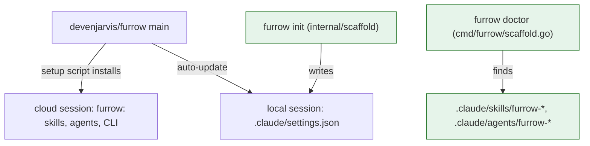

# FUR-0020: Every repo gets the latest Furrow plugin, with nothing copied in

## Why

Fetch, Edition and Cookiemom each copy Furrow's skills and agents into `.claude/`, so every change
to them needs a PR in every repo, and the copies drift. The owner wants every repo on the latest
Furrow. The plugin can reach every session instead: a cloud environment's setup script installs it
(cloud sessions ignore plugins a repo declares), and a repo's `.claude/settings.json` declares it
for local sessions. Furrow should make that the way you use it, and say when old copies hide it.

## What

### How a session gets Furrow



Legend: a box is a file, command or session; each arrow says what it does; green is new or changed.

### The plugin's version

`.claude-plugin/plugin.json` has no `version`. With none, Claude Code takes the commit as the
version, so every commit to `main` is an update for installs with auto-update on. The
marketplace entry has no `version` either.

### README: "Use Furrow in your repos"

A new README section says, in this order:

1. **Cloud sessions.** Add this to the cloud environment's setup script. It runs in each fresh
   container, so every session gets `main`'s skills, agents and CLI together:

   ```sh
   claude plugin marketplace add devenjarvis/furrow || true
   claude plugin install furrow@furrow || true
   GOBIN=/usr/local/bin go install github.com/devenjarvis/furrow/cmd/furrow@main || true
   ```

2. **Local sessions.** `furrow init` writes the plugin into `.claude/settings.json` (below).
   Claude Code installs it once the folder is trusted, and auto-update keeps it current.
3. **Don't copy the skills or agents into the repo.** A project's `.claude/agents/furrow-*` take
   priority over the plugin's, so a copy hides its fixes, model pins included. Its skills show up
   twice, as `/furrow-swarm` and `/furrow:furrow-swarm`. `furrow doctor` lists any copies.

### `furrow init` and `.claude/settings.json`

`furrow init` also handles `.claude/settings.json`:

- **No file:** it writes this file, and prints `wrote .claude/settings.json (the Furrow plugin)`:

  ```json
  {
    "extraKnownMarketplaces": {
      "furrow": {
        "source": { "source": "github", "repo": "devenjarvis/furrow" },
        "autoUpdate": true
      }
    },
    "enabledPlugins": {
      "furrow@furrow": true
    }
  }
  ```

- **A file that already enables `furrow@furrow`:** it changes nothing and prints nothing about it.
- **A file without it:** it doesn't edit the file. It prints
  `.claude/settings.json exists: add the Furrow plugin to it:` and the two keys above, and exits 0.
  It never rewrites a file it didn't create, so the owner's formatting and other keys stay.
- **A file that isn't valid JSON:** it says `.claude/settings.json isn't valid JSON; the Furrow
  plugin wasn't added`, changes nothing, and exits 0. `init` keeps going with its other files.

The JSON is written with the standard library (INV-7), with two-space indents and a final newline.

### `furrow doctor` and copies

`furrow doctor` also lists Furrow's skills and agents copied into the repo: every directory
`.claude/skills/furrow-*` and every file `.claude/agents/furrow-*.md`, sorted. When there are any,
it prints:

```
Copies of Furrow's skills and agents hide the plugin's:
  .claude/agents/furrow-builder.md
  .claude/skills/furrow-swarm
Delete them and use the plugin: see "Use Furrow in your repos" in Furrow's README.
```

It still exits 0. `--json` gains `"copies": [...]`, an empty list when there are none. With no
`bin/furrow`, doctor still reports copies and leaves the pin fields empty, rather than failing.

## Acceptance criteria

- [ ] AC-1: `.claude-plugin/plugin.json` and `.claude-plugin/marketplace.json` have no `version`. (check: ! grep -q '"version"' .claude-plugin/plugin.json .claude-plugin/marketplace.json)
- [ ] AC-2: The README has a "Use Furrow in your repos" section with the setup script, the local settings, and the warning about copies. (check: grep -q "Use Furrow in your repos" README.md && grep -q "claude plugin install furrow@furrow" README.md)
- [x] AC-3: `furrow init` writes `.claude/settings.json` with the Furrow marketplace and plugin when there's no file, leaves a file that already enables the plugin alone, and prints the keys without editing any other file. (test: TestInitPluginSettings)
- [x] AC-4: `furrow init` with a `.claude/settings.json` that isn't valid JSON says so, changes nothing, and exits 0. (test: TestInitPluginSettingsBadJSON)
- [x] AC-5: `furrow doctor` lists copied `.claude/skills/furrow-*` directories and `.claude/agents/furrow-*.md` files, sorted, in its text and as `copies` in `--json`, exits 0, and works without `bin/furrow`. (test: TestDoctorCopies)
- [x] AC-6: `make check` passes. (check: make check)
- [ ] AC-7: A fresh cloud session on an environment with the README's setup script has the `furrow:` skills and agents and `furrow` on its PATH. (human: start a session and ask it to list them)

## Out of scope

- Editing any other repo. Fetch, Edition and Cookiemom remove their copies in their own specs.
- Changing a cloud environment from Furrow. The owner edits the setup script.
- Removing `furrow init --pin` or the shim. A repo that wants a pinned CLI still can.
- Merging keys into an existing `.claude/settings.json`.

## Open questions

- Should the setup script install the CLI from `main` or the latest release tag? Proposed: `main`, so the CLI always matches the skills, which come from `main`.
- Should `furrow doctor` exit 1 when it finds copies, so CI can catch them? Proposed: no, exit 0; a repo that wants it enforced can check `copies` in `--json`.

## Decisions

- 2026-11-07: Chose to print the whole settings object for an existing file, because it holds exactly the two keys and pastes as valid JSON.
- 2026-11-07: Chose json.MarshalIndent over a literal, so `source` spans lines rather than one line as the spec shows; the content and key order match.
- 2026-11-07: Chose to skip `git ls-remote` without `bin/furrow`, so doctor works offline; `shim` keeps its path and `latest` is empty.
