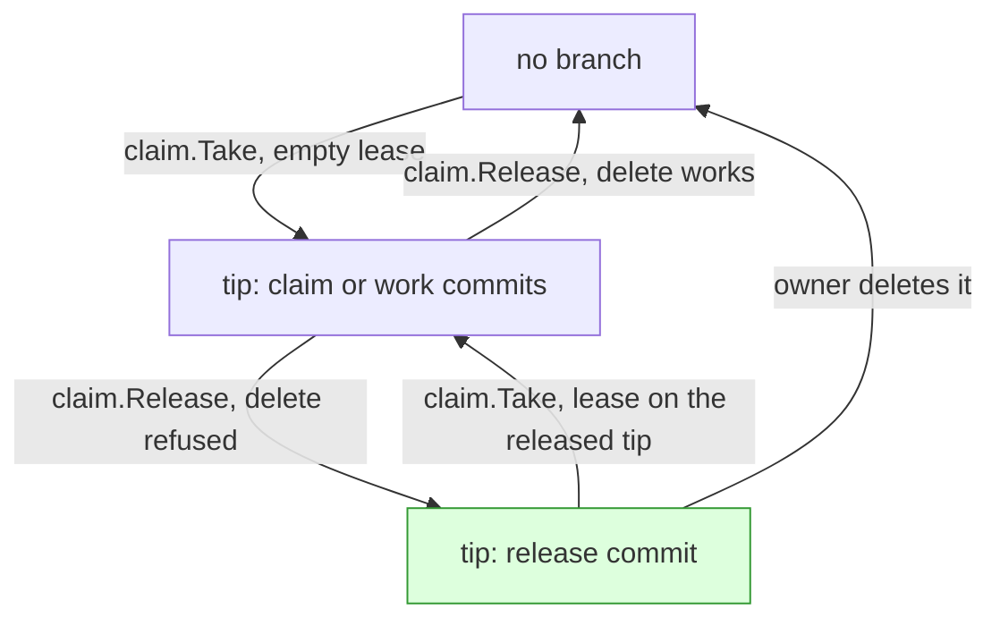

# FUR-0022: Release a claim where branches can't be deleted

## Why

A claim is a branch, and `furrow release` gives it back by deleting that branch. Cloud agents,
such as Claude Code on the web, can push commits but can't delete branches, so a claim they take
can't be given back: the step stays claimed until the owner deletes the branch by hand. Releasing
should work wherever an agent can push a commit.

## What

**A release commit.** A claim branch whose tip commit is a *release commit* is released: furrow
treats the step as unclaimed, exactly as if the branch were gone. A release commit changes nothing
(its tree is its parent's tree), its parent is the branch's tip, and its message is

```
Release FUR-0004.1

furrow-release: <16 hex chars, random>
```

The trailer's value is a nonce, like `furrow-claim:`, so every release commit is unique. Only the
tip counts: a release commit deeper in a branch's history means nothing. The constant is
`claim.ReleaseTrailer = "furrow-release"`.

**`furrow release <ref>`** first tries what it does today, `git push <remote> --delete
refs/heads/<branch>`. If the remote refuses (any failed delete while `ls-remote` just answered),
it makes a release commit on the branch's tip, as `ls-remote` reported it, and pushes it with
`--force-with-lease=refs/heads/<branch>:<that tip>`. That push is a fast-forward, so a remote that
refuses deletes and non-fast-forward pushes still takes it.

```
$ furrow release FUR-0004.1
Released FUR-0004.1: deleted step/0004-1 on origin.

$ furrow release FUR-0004.1          # where deletes are refused
Released FUR-0004.1: origin wouldn't delete step/0004-1, so furrow marked it released.
Delete the branch when you can; until then furrow treats it as free.

$ furrow release FUR-0004.1          # already released
FUR-0004.1 isn't claimed (step/0004-1 on origin is released).
```

Failure modes, each exiting 1:

- The remote can't be reached: `claim.ErrRemote`, as today.
- The branch moved between `ls-remote` and the push (the lease fails): `step/0004-1 moved while
  furrow was releasing it. Run furrow release FUR-0004.1 again.`
- The delete and the release push both fail for another reason: the release push's error, wrapped
  in `claim.ErrRemote`.

Releasing an unclaimed or already-released step exits 0. `--json` prints `{"ref", "branch",
"released", "how"}` where `how` is `deleted`, `marked` or `""` (nothing to release).

**Reading claims.** `claim.List` drops released branches, so `furrow next`, `furrow claim`,
`furrow status` and the brief all see the step as free. To read the tips it fetches the claim
branches into `refs/furrow/claims/` (as `claim.FetchClaims` does; one fetch, and none when there
are no claim branches) and checks each tip's message for a `furrow-release:` trailer. A fetch that
fails is `claim.ErrRemote`. `claim.ReadStack` reuses those refs. A new
`claim.ListAll` returns every claim branch, released ones included, with `Released bool` set; `List`
is `ListAll` with released ones removed.

**Claiming a released branch.** `furrow claim` on a step whose branch exists but is released makes
its claim commit as usual on base (or on the stack parent's tip), but with **two parents**: base
(or the parent's tip) first, the released tip second. Its tree is still base's tree, so the branch
starts exactly where a fresh claim would, and `git diff <base>...HEAD` is empty. It pushes with
`--force-with-lease=refs/heads/<branch>:<released tip>`. That is a fast-forward, and the lease makes
it atomic: of two agents re-claiming the same released branch, exactly one wins and the other exits
3 with the usual `FUR-0004.1 is already claimed (step/0004-1). Run furrow next for another step.`
The output, `--json` and checkout are the same as any claim. `claim.ClaimCommit` already picks the
newest claim commit, so territory and stacking read the new one.

What a branch's tip says, and what each command does with it:



Legend: a box is what the claim branch on the remote looks like; an arrow is the command or person
that moves it there; green is new.

**`furrow claims`** lists released branches too, so the owner can see what to delete, with state
`released` and the note `(released: delete the branch when you can)`. A released claim is never
`stale` or `leftover`. `--json` gives `"state": "released"`.

```
FUR-0004.1  step/0004-1  released  3h  (released: delete the branch when you can)
```

**The skills.** `skills/furrow-swarm/SKILL.md` and any other skill that says to ask the owner to
delete a branch say to run `furrow release` instead, and that a released branch can be deleted by
the owner later but needn't be. `furrow status` keeps its `Next:` line: released claims aren't
claims, so they don't count as stale or leftover.

## Before and after

**Before:** In a cloud session, `furrow release` fails and the step stays claimed until the owner deletes it.

```
$ furrow release FUR-0004.1
error: git push -q origin --delete refs/heads/step/0004-1: ... (refused)
$ furrow next
Nothing is ready to start.
```

**After:** The release falls back to a release commit, and the step is free at once.

```
$ furrow release FUR-0004.1
Released FUR-0004.1: origin wouldn't delete step/0004-1, so furrow marked it released.
Delete the branch when you can; until then furrow treats it as free.
$ furrow next
FUR-0004.1  Prove a step's diff stays inside its touches
```

## Acceptance criteria

- [ ] AC-1: Against a remote with `receive.denyDeletes=true`, `furrow release` pushes a release commit (tree unchanged, parent the old tip, a `furrow-release:` trailer) and prints the "marked it released" message. (test: TestReleaseMarksWhenDeleteRefused)
- [ ] AC-2: Against a remote that allows deletes, `furrow release` still deletes the branch. (test: TestReleaseDeletes)
- [ ] AC-3: Releasing a step whose branch is already released, or doesn't exist, exits 0 and says it isn't claimed. (test: TestReleaseAlreadyReleased)
- [ ] AC-4: When the branch moves between `ls-remote` and the release push, `furrow release` exits 1 with the "moved while furrow was releasing it" message and pushes nothing. (test: TestReleaseLeaseLost)
- [ ] AC-5: `claim.List` leaves out a branch whose tip is a release commit and keeps one with a release commit deeper in its history; `claim.ListAll` returns both, with `Released` set. (test: TestListDropsReleased)
- [ ] AC-6: After a release commit, `furrow next` offers the step again. (test: TestNextOffersReleasedStep)
- [ ] AC-7: Against a remote with `receive.denyDeletes=true` and `receive.denyNonFastForwards=true`, `furrow claim` on a released step succeeds; the claim commit's first parent is base, its second the released tip, its tree base's, and `git diff origin/main...HEAD` is empty. (test: TestClaimReleasedBranch)
- [ ] AC-8: Two agents claiming the same released branch: exactly one succeeds and the other exits 3 with the "already claimed" message. (test: TestClaimReleasedBranchRace)
- [ ] AC-9: `furrow claims` shows a released branch as `released` with its note, and `--json` gives `"state": "released"`. (test: TestClaimsShowsReleased)
- [ ] AC-10: `furrow release --json` prints `ref`, `branch`, `released` and `how`. (test: TestReleaseJSON)
- [x] AC-11: No skill tells an agent to ask the owner to delete a claim branch; each says to run `furrow release`. (check: ! grep -rn "ask the owner to delete" skills/)
- [ ] AC-12: In a Claude Code cloud session, release a claimed step, see `furrow next` offer it again, and claim it. (human: run it in a cloud session on a throwaway step)

## Out of scope

- Deleting released branches later from furrow (a `prune` command). The owner deletes them, or
  doesn't; they cost nothing.
- Using a forge's API to delete a branch (INV-2).
- Force-pushing or rewriting a claim branch in any way that isn't a fast-forward.
- Closing a released step's PR. The agent or owner does that; re-claiming reuses the branch, so an
  old PR left open would pick up the new claim's commits.
- Changing `furrow done`, archive or territory.

## Open questions

- Should `furrow release` try the delete first, or always push a release commit?
  Proposed: try the delete first, and fall back to a release commit only when it's refused, so
  remotes that allow deletes stay tidy and nothing changes for them.
- A re-claim of a released branch keeps the abandoned work in its history (as the second
  parent), so a PR on it lists those old commits, though its diff is empty. Is that acceptable?
  Proposed: yes. The alternative, refusing to re-claim until the owner deletes the branch, brings
  back the problem this spec fixes.
- Should `claim.List` fetch the claim branches every time, which `furrow next` didn't need
  before with stacking off?
  Proposed: yes. It's one fetch of objects that are mostly there already, and it's the only way to
  read a tip without a cache (INV-1).

## Decisions

- 2026-11-14: Step 2 edits only the swarm's Tidy lines, the one place any skill sent branch deletes to the owner; `specs/areas/agents.md` is left as is, since it never mentioned deleting.
